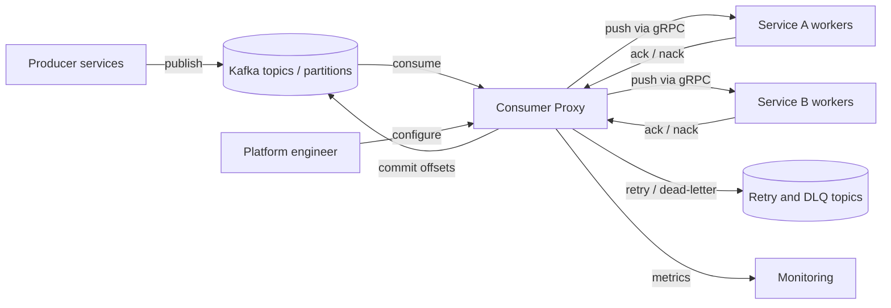

# SRS: Consumer Proxy for Kafka Event Consumption

| Field | Value |
|---|---|
| **Status** | Proposed (academic case study) |
| **Version** | 0.2 |
| **Date** | 2026-10-25 |
| **Authors** | [pelu Jeremiah] |
| **Reviewers / approvers** | [Dr. Attila Adamkó Tamás] |
| **Related ADRs** | [ADR-0001](../adr/adopt-consumer-proxy.md), [ADR-0002](../adr/choose-at-least-once-delivery.md), [ADR-0003](../adr/define-per-key-ordering-mode.md), [ADR-0004](../adr/choose-retry-and-dead-letter-policy.md) |

**Evidence labels:** **[Fact]** documented and cited, **[Assumption]** not verified, **[Proposal]** our own design.
These are **proposed** requirements derived from a public case study. They are **not** Uber's internal requirements.

---

## 1. Introduction

### 1.1 Purpose
This document specifies the requirements for a **Consumer Proxy** that sits between Apache Kafka and consumer
services in an event-driven architecture. It is the requirements counterpart to ADR-0001 and supports the
head-of-line (HOL) blocking case study presented earlier.

### 1.2 Scope
| In scope | Out of scope |
|---|---|
| Reading events from Kafka topics on behalf of consumer services | Kafka brokers and their replication |
| Pushing events to services, acknowledgment, retry, dead-letter handling | Event producers |
| Offset tracking and commit | Business logic inside consumer services |
| HOL detection and mitigation, observability, configuration | Schema design of event payloads |

### 1.3 Definitions, acronyms and abbreviations
| Term | Definition |
|---|---|
| **Event / message** | A record published to a Kafka topic. |
| **Partition** | An ordered, append-only log inside a topic. |
| **Consumer group** | Consumers that share the partitions of a topic; each partition has at most one consumer in the group. |
| **Offset** | The position of a message within a partition. |
| **HOL blocking** | A small number of unprocessed messages blocking the majority behind them in the same partition. |
| **Ack / nack** | Positive / negative acknowledgment of a message by a service. |
| **DLQ** | Dead-letter queue (topic) for messages that cannot be processed. |
| **Idempotent consumer** | A consumer for which processing the same message twice has the same effect as once. |
| **Contiguous acknowledged offset** | The highest offset N such that every offset up to N is acked or dead-lettered. |

### 1.4 References
1. Uber Engineering, *Introducing uForwarder: The Consumer Proxy for Kafka Async Queuing* (uber.com/blog). **[Fact]**: Uber built a push-based consumer proxy, exposes a gRPC interface instead of direct Kafka access, over 1,000 consumer services onboarded, challenges include partition scalability, HOL blocking and multi-language support.
2. Apache Kafka documentation: consumers, consumer groups and offsets (kafka.apache.org).
3. ISO/IEC/IEEE 29148:2018, *Requirements engineering*.
4. Architecture decision record repository (github.com/architecture-decision-record/architecture-decision-record).
5. [ADR-0001](../adr/adopt-consumer-proxy.md).

### 1.5 Document overview
Section 2 describes the context, section 3 lists the requirements, section 4 traces them to the problem and the ADR,
section 5 explains how they will be verified, and sections 6 to 8 hold open issues, the decision log and revision history.

## 2. Overall description

### 2.1 Product perspective
The proxy is a new layer between the broker and consumer services. Services no longer embed a Kafka client.

**Before:** each service holds a Kafka client, pulls from its assigned partitions and commits sequentially.
**After:** the proxy reads Kafka, dispatches messages concurrently, and commits based on per-message acknowledgments.

### 2.2 Product functions (summary)
- Push events to services over gRPC and collect per-message acknowledgments.
- Process messages in parallel and commit offsets safely.
- Retry failed messages, dead-letter exhausted ones, detect and relieve HOL blocking.
- Optionally keep order per key.
- Expose configuration and metrics.

### 2.3 User classes and characteristics
| User class | Description | Main needs |
|---|---|---|
| Service developer | Writes a consumer service in any language | A simple gRPC contract; no Kafka code |
| Platform / SRE engineer | Operates the proxy | Configuration, monitoring, safe rollouts |
| On-call engineer | Responds to incidents | Clear signals for lag, HOL events and DLQ growth |

### 2.4 Operating environment
Kafka cluster; containerised proxy instances horizontally scaled; gRPC between proxy and services. **[Assumption]**

### 2.5 Design and implementation constraints
- Kafka remains the system of record for events.
- Delivery semantics are **at-least-once**; exactly-once is out of scope ([ADR-0002](../adr/choose-at-least-once-delivery.md)).
- Services must expose a gRPC endpoint that implements the delivery contract.

### 2.6 Assumptions and dependencies
| ID | Assumption / dependency | Label | Risk if wrong |
|---|---|---|---|
| A-01 | Most consumer workloads tolerate out-of-order processing across keys | [Assumption] | Need per-key mode more widely (FR-10) |
| A-02 | Consumer services can be made idempotent (see ADR-0002) | [Assumption] | Duplicates cause incorrect side effects |
| A-03 | All numeric targets below are starting values to be tuned by measurement | [Assumption] | Targets may be too strict or too loose |
| A-04 | Kafka broker availability is outside this system's control | [Assumption] | Proxy availability is bounded by Kafka's |

## 3. Specific requirements

### 3.1 External interface requirements
| ID | Interface | Description | Protocol / format | Verification |
|---|---|---|---|---|
| IF-01 | Kafka | Consume from subscribed topics; commit offsets; publish to retry and DLQ topics | Kafka protocol | Integration test |
| IF-02 | Service delivery API | Proxy pushes a message with ID, key, offset, headers and payload; service replies ack or nack | gRPC **[Fact: Uber exposes a gRPC interface]** | Contract test |
| IF-03 | Admin API | Register a consumer group, endpoint, concurrency, retry policy | gRPC or REST **[Proposal]** | Demo |
| IF-04 | Metrics | Export operational metrics | Prometheus-style endpoint **[Assumption]** | Inspection |

### 3.2 Functional requirements
| ID | Requirement | Priority | Rationale | Source / ADR | Verification | Label |
|---|---|---|---|---|---|---|
| FR-01 | The proxy shall consume messages from the topics configured for a registered consumer group. | Must | Core purpose | ADR-0001 | Integration test | Proposal |
| FR-02 | The proxy shall push each message to the registered service endpoint over gRPC. | Must | Removes Kafka client from services; multi-language support | ADR-0001; Uber blog | Contract test | Fact (approach) / Proposal (detail) |
| FR-03 | The proxy shall require an ack or nack for every delivered message. | Must | Enables per-message progress tracking | ADR-0001, ADR-0002 | Test | Proposal |
| FR-04 | The proxy shall allow up to *N* in-flight messages per partition, where *N* is configurable per consumer group. | Must | Decouples parallelism from partition count | ADR-0001 | Load test | Proposal |
| FR-05 | The proxy shall commit to Kafka only the highest contiguous acknowledged offset. | Must | Prevents message loss when processing is out of order | ADR-0001, ADR-0002 | Fault-injection test | Proposal |
| FR-06 | On nack or timeout, the proxy shall retry the message up to a configurable number of attempts with backoff, via a retry topic. | Must | Resilience without blocking | ADR-0001, ADR-0002, ADR-0004 | Test | Proposal |
| FR-07 | After retries are exhausted, the proxy shall publish the message to a dead-letter topic with failure metadata and treat it as resolved for offset purposes. | Must | Lets the commit advance past poison messages | ADR-0001, ADR-0004 | Test | Proposal |
| FR-08 | The proxy shall detect a possible HOL block when the oldest unacknowledged message in a partition exceeds a configurable age while newer messages are acknowledged. | Must | Early detection; Uber describes detection and mitigation steps | ADR-0001, ADR-0004; Uber blog | Fault-injection test | Fact (concept) / Proposal (rule) |
| FR-09 | When HOL blocking is detected, the proxy shall move the blocked message to a retry or dead-letter topic so that the commit can advance. | Must | Mitigation | ADR-0001, ADR-0004; Uber blog | Fault-injection test | Fact (concept) / Proposal (rule) |
| FR-10 | The proxy should offer an optional per-key ordering mode in which messages with the same key are delivered one at a time in order. | Should | Preserves ordering where needed | ADR-0001, ADR-0003 | Ordering test | **Proposal, our extension; not claimed for Uber** |
| FR-11 | The proxy shall isolate consumer groups from one another so that a slow service cannot exhaust resources of another. | Should | Fault isolation | ADR-0001 | Load test | Proposal |
| FR-12 | The proxy shall let an authorised engineer register or change a consumer group's endpoint, concurrency and retry policy without redeploying services. | Should | Operability | ADR-0001 | Demo | Proposal |
| FR-13 | The proxy shall expose metrics for consumer lag, in-flight count, ack latency, retry count, DLQ count and HOL events. | Must | Needed to evaluate the solution | ADR-0001 | Inspection | Proposal |
| FR-14 | On partition reassignment, the proxy shall not lose acknowledged progress and shall redeliver unacknowledged messages. | Must | Safe rebalancing | ADR-0001, ADR-0002 | Fault-injection test | Proposal |

### 3.3 Quality attribute (non-functional) requirements
> All numeric targets are **starting values to validate by measurement** (assumption A-03).

| ID | Attribute | Requirement (metric and target) | Priority | Source / ADR | Verification | Label |
|---|---|---|---|---|---|---|
| NFR-P1 | Performance | Proxy-added latency shall be at most **10 ms at p99** under nominal load. | Must | ADR-0001 negative consequence (extra hop) | Benchmark | Assumption |
| NFR-P2 | Performance | End-to-end event latency p99 with injected slow messages shall be lower than the direct-consumer baseline. | Must | Problem statement | A/B test | Proposal |
| NFR-P3 | Performance | A blocked message shall be removed from the commit path within a configurable time (**default 60 s**). | Must | FR-08, FR-09; ADR-0004 | Fault injection | Assumption |
| NFR-S1 | Scalability | Throughput for a topic shall increase when worker instances are added beyond the number of partitions. | Must | Root cause: parallelism = partitions | Load test | Proposal |
| NFR-R1 | Reliability | The proxy shall provide at-least-once delivery with no loss of acknowledged or unacknowledged messages. | Must | ADR-0001, ADR-0002 | Fault injection | Proposal |
| NFR-R2 | Reliability | After a proxy instance failure, processing shall resume within **30 s**. | Should | ADR-0001 risk | Chaos test | Assumption |
| NFR-A1 | Availability | The proxy shall target **99.9 %** monthly availability, excluding Kafka outages. | Should | ADR-0001 risk (single point of failure) | Monitoring | Assumption |
| NFR-SEC1 | Security | Proxy-to-service and proxy-to-Kafka traffic shall be authenticated and encrypted; each consumer group shall access only authorised topics. | Must | Standard practice | Security review | Assumption |
| NFR-M1 | Maintainability | A new service in any language supporting gRPC shall be onboarded using only the delivery contract, with no Kafka client library. | Must | Uber blog (multi-language support issue) | Demo | Fact (problem) / Proposal (target) |
| NFR-C1 | Consistency | The delivery contract shall carry a stable message ID so consumers can deduplicate; ordering guarantees shall be documented per mode (default: none across keys; per-key mode: ordered per key). | Must | ADR-0001 negative consequences; ADR-0002 | Review and test | Proposal |

### 3.4 Other requirements
- Retention of retry and dead-letter topics shall be configurable, with a documented default. **[Proposal]**
- Messages in dead-letter topics shall be replayable by an authorised engineer. **[Proposal]**

## 4. Traceability matrix
| Problem / root cause | Requirement IDs | ADR | Verification |
|---|---|---|---|
| Symptom: consumer lag and latency spikes | FR-13, NFR-P2 | ADR-0001 | A/B test with injected slow messages |
| Root cause 1: ordering unit = parallelism unit | FR-04, FR-10, NFR-S1 | ADR-0001, ADR-0003 | Load and ordering tests |
| Root cause 2: single sequential offset commit | FR-03, FR-05, FR-07, FR-09, FR-14 | ADR-0001, ADR-0002, ADR-0004 | Fault-injection tests |
| Root cause 3: consume logic embedded in every service | FR-02, FR-12, NFR-M1 | ADR-0001 | Contract test, demo |
| Consequence: scalability cap and partition-level unavailability | NFR-S1, NFR-P3 | ADR-0001 | Load and fault-injection tests |
| New risks: extra hop, proxy as critical component, duplicates | NFR-P1, NFR-R2, NFR-A1, NFR-C1 | ADR-0001, ADR-0002 | Benchmark, chaos test, review |

## 5. Verification and evaluation plan
Run an **A/B comparison** on the same topic and traffic: direct Kafka consumers versus consumers behind the proxy,
with deliberately injected slow and poison messages.

| Measure | Compared between | Expected direction (hypothesis, not a result) |
|---|---|---|
| End-to-end event latency p50 / p99 | Baseline vs. proxy | p99 lower under slow-message injection |
| Consumer lag and time to recover | Baseline vs. proxy | Lower |
| Throughput per partition | Baseline vs. proxy | Higher when workers exceed partitions |
| Error and duplicate rate | Baseline vs. proxy | Not worse than the at-least-once baseline |
| Recovery time after instance failure | Baseline vs. proxy | Within NFR-R2 |
| Ordering violations in per-key mode | Proxy | Zero |

**Acceptance criteria:** every *Must* requirement passes its verification method, and the proxy meets NFR-P1, NFR-P3 and NFR-R2 in the test environment.

## 6. Open issues and risks
| ID | Issue / risk | Owner | Due | Status |
|---|---|---|---|---|
| OI-01 | Validate all numeric targets (assumption A-03) with a prototype | [Your name] | TBD | Open |
| OI-02 | Tune the retry and dead-letter defaults proposed in ADR-0004 by measurement | [Your name] | TBD | Open |
| OI-03 | Check whether Kafka-native queue-style consumption (share groups, KIP-932) meets the need in the Kafka version in use | [Your name] | TBD | Open |
| OI-04 | Define the idempotency guidance for service teams (follow-up of ADR-0002) | [Your name] | TBD | Open |

## 7. Decision log
| ADR | Title | Status |
|---|---|---|
| [ADR-0001](../adr/adopt-consumer-proxy.md) | Adopt a consumer proxy between Kafka and consumer services | Proposed |
| [ADR-0002](../adr/choose-at-least-once-delivery.md) | Choose at-least-once delivery with idempotent consumers | Proposed |
| [ADR-0003](../adr/define-per-key-ordering-mode.md) | Define an optional per-key ordering mode | Proposed |
| [ADR-0004](../adr/choose-retry-and-dead-letter-policy.md) | Choose a retry and dead-letter topic policy | Proposed |

## 8. Revision history
| Version | Date | Change | Author |
|---|---|---|---|
| 0.1 | 2026-10-25 | Created | [Pelu Jeremiah] |
| 0.2 | 2026-10-27 | Added ADR-0003 and ADR-0004; updated traceability, decision log and open issues | [Pelu Jeremiah] |
