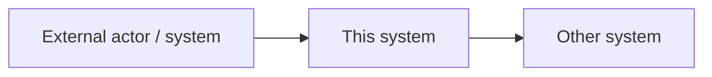

# SRS: <System or component name>

> **How to use this template.** Copy it, rename the file with a present-tense verb phrase
> (`define-<system>-requirements.md`), delete the guidance blockquotes, and fill every section.
> Structure follows ISO/IEC/IEEE 29148:2018; the header, status, date-stamping, rationale and
> decision links follow the ADR project's recommendations.

| Field | Value |
|---|---|
| **Status** | Draft / Proposed / Accepted / Superseded by [link] |
| **Version** | 0.1 |
| **Date** | YYYY-MM-DD |
| **Authors** | Names or roles |
| **Reviewers / approvers** | Names or roles |
| **Related ADRs** | [ADR-0001](../adr/<file>.md) |

**Evidence labels:** **[Fact]** documented and cited, **[Assumption]** not verified, **[Proposal]** our own design.

---

## 1. Introduction

### 1.1 Purpose
> Why does this document exist and who is it for?

### 1.2 Scope
> What the system will do, and what is explicitly **out of scope**.

| In scope | Out of scope |
|---|---|
| | |

### 1.3 Definitions, acronyms and abbreviations
| Term | Definition |
|---|---|
| | |

### 1.4 References
> Standards, official documentation, papers, related ADRs. Cite sources.

### 1.5 Document overview
> One short paragraph describing how the rest of the document is organised.

## 2. Overall description

### 2.1 Product perspective
> Where the system sits among other systems. Add a context diagram (Mermaid renders on GitHub).

### 2.2 Product functions (summary)
> A short list of major capabilities. Details go in section 3.

### 2.3 User classes and characteristics
| User class | Description | Main needs |
|---|---|---|
| | | |

### 2.4 Operating environment
### 2.5 Design and implementation constraints
> Technology, regulation, standards, organisational limits.

### 2.6 Assumptions and dependencies
| ID | Assumption / dependency | Label | Risk if wrong |
|---|---|---|---|
| A-01 | | [Assumption] | |

## 3. Specific requirements

> **Writing rules.** One requirement per row. Use "shall" for mandatory, "should" for desirable.
> Each requirement must be unambiguous, testable and traceable. Give every requirement a unique, never-reused ID.

### 3.1 External interface requirements
| ID | Interface | Description | Protocol / format | Verification |
|---|---|---|---|---|
| IF-01 | | | | |

### 3.2 Functional requirements
| ID | Requirement | Priority (MoSCoW) | Rationale | Source / ADR | Verification | Label |
|---|---|---|---|---|---|---|
| FR-01 | The system shall ... | Must | | | Test / Inspection / Demo / Analysis | |

### 3.3 Quality attribute (non-functional) requirements
> Make each one measurable: metric, target, measurement condition.

| ID | Attribute | Requirement (metric and target) | Priority | Source / ADR | Verification | Label |
|---|---|---|---|---|---|---|
| NFR-P1 | Performance | | | | | |
| NFR-S1 | Scalability | | | | | |
| NFR-R1 | Reliability | | | | | |
| NFR-A1 | Availability | | | | | |
| NFR-SEC1 | Security | | | | | |
| NFR-M1 | Maintainability | | | | | |
| NFR-C1 | Consistency | | | | | |

### 3.4 Other requirements
> Legal, data retention, localisation, regulatory.

## 4. Traceability matrix
| Problem / driver | Requirement IDs | ADR | Verification |
|---|---|---|---|
| | | | |

## 5. Verification and evaluation plan
> How you will show each requirement is met: metrics, test setup, acceptance criteria.

## 6. Open issues and risks
| ID | Issue / risk | Owner | Due | Status |
|---|---|---|---|---|
| | | | | |

## 7. Decision log
| ADR | Title | Status |
|---|---|---|
| [ADR-0001](../adr/<file>.md) | | |

## 8. Revision history
> Do not silently change old text. Add a dated row, and note when information arrived after the decision.

| Version | Date | Change | Author |
|---|---|---|---|
| 0.1 | YYYY-MM-DD | Created | |
